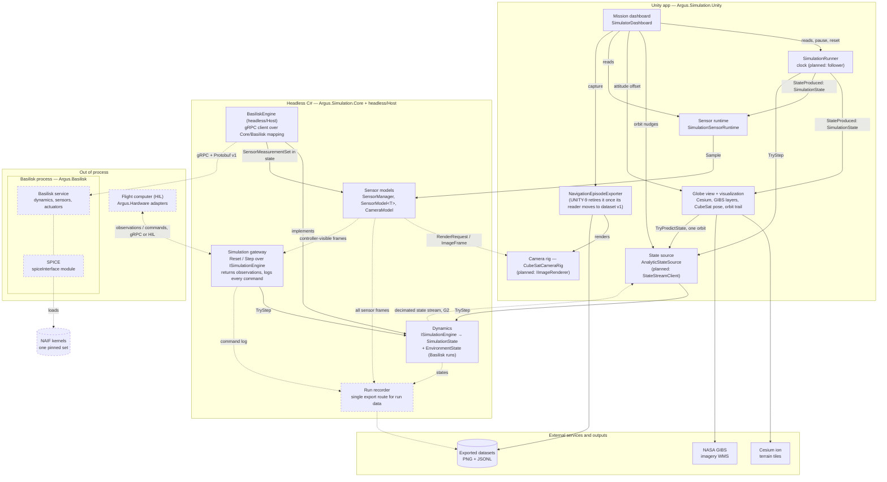
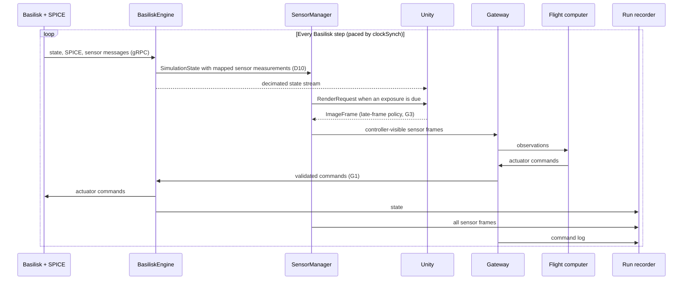

# Argus Simulator — Target Architecture

Status: agreed target design. Baseline: `main` at `da9475b` (2026-09-30), which includes the
Phase 1 structure change that added this document and the other items marked done in §10.

This document records where the simulator is going, the decisions behind it, and the gaps
still open. [system-architecture.md](system-architecture.md) holds the original principles
and the current contracts; where the two differ, the decisions here take precedence.
[code-organization.md](code-organization.md)
is the authoritative class and folder map.

Legend used throughout: **main** means the code exists on `main`; **planned** means it
is not implemented yet (some planned pieces hold an inert placeholder file; see
[code-organization.md](code-organization.md#placeholders-and-todos)).

## 1. Block diagram

Solid boxes and arrows exist on `main`. Dashed boxes and arrows are planned; a solid box
with "(planned: …)" exists but gains that role later.



## 2. Blocks

| Block | Where | On `main` today | Target role | Status |
|---|---|---|---|---|
| Globe view + visualization | `Unity/Cesium/`, `Unity/Visualization/` | Cesium tileset, GIBS layers, globe camera, CubeSat pose, orbit trail; fixed Sun light | Sun light and night side follow the state's environment; orbit trail from state history | main (environment lighting planned) |
| Camera rig / renderer | `Unity/Cameras/` | `CubeSatCameraRig` renders 4 body cameras and a north-up nadir ground-truth camera every frame | Implements `IImageRenderer`: renders each `CameraModel` `RenderRequest` and returns an `ImageFrame` | main (renderer role planned) |
| SimulationRunner | `Unity/Runtime/SimulationRunner.cs` | Publishes whole `SimulationState`s from its `ISimulationStateSource`; clock for the step-driven analytic source (fixed 0.1 s steps from Unity frame time × time scale) | Follower: broadcasts states received from the headless core | main (follower planned) |
| State source | `Unity/Runtime/AnalyticStateSource.cs` (`IStepDrivenStateSource`) | Wraps the analytic engine in the Unity process and publishes whole states | `StateStreamClient` (`ISimulationStateSource`) for Basilisk runs; `BasiliskEngine` runs in the headless core (G2). The analytic source stays for development | main (stream client planned) |
| Sensor runtime | `Unity/Sensors/` | Temporary bridge feeding each state to a Core `SensorManager` | Moves into the headless core (G2); Unity only displays frames | main (temporary) |
| Mission dashboard | `Unity/UI/` | Truth from `SimulationState`, body-rate status from the sensor runtime, camera status from the rig, fixed text for the other sensors, orbit and attitude nudges, GT imagery date, capture | Same, listing sensors from received frames; nudges become engine commands | main (received sensor list (G2) and nudges as commands (G1) planned) |
| Navigation episode exporter | `Unity/Export/NavigationEpisodeExporter.cs` | Pauses the runner, renders the cameras, writes PNG + JSONL | UNITY-9 (#63) retires it once its reader moves to dataset v1 (D6, #69) | main (to retire) |
| Dynamics | `Core/Dynamics/`, `Core/Contracts/` | `AnalyticSimulationEngine` + `CircularOrbitModel`; the analytic engine reports no environment | `ISimulationEngine` returns a `SimulationState` with `EnvironmentState` in Basilisk runs; the analytic engine stays as a test fixture | main (contract done; producer planned) |
| Sensor models | `Core/Sensors/`, `Core/Sensors/Camera/` | `SensorManager`, `SensorModel<T>`, `IdealBodyRateSensorModel`; `BackendSensorModel<T>` with `ImuSensor`, `MagnetometerSensor`, `LightSensor`; `CameraModel` and the Argus-computed `BodyCameraModel` and `NadirGroundTruthCameraModel` (CORE-8), built by `CameraKind` and `NadirGroundTruthCameraKind` through `SensorFactory` with the renderer the host or Unity supplies (CORE-18) | Adds rendering on request (UNITY-4); the backend sensors publish what `BasiliskEngine` maps from Basilisk sensors (D10) | main (the four P0 body cameras with the DATA-6 profile, CORE-6) |
| Simulation gateway | `Core/Runtime/SimulationGateway.cs` | `Reset(seed, scenario)` and `Step(command k)` over `ISimulationEngine` in the DATA-5 order; returns controller-visible observations, and truth only through `StateProduced`; owns the run's `SensorManager`; logs every command it receives, applied or rejected, through `CommandLogged` (`CommandRecord`); used by the tests (analytic engine) and by `headless/Host` (over `BasiliskEngine`) | Live link for HIL flight computers and other external controllers: controller-visible sensor frames out, commands in, command log to the recorder | main (host and tests; limits CORE-10, authority CORE-9) |
| BasiliskEngine | `headless/Host/Basilisk/`, `Core/Basilisk/` | gRPC client of the v1 Basilisk link over the internal Core mapping; verified on real Basilisk and SPICE with the full P0 scenario (HOST-4 #28, HOST-5 #29) | Builds states from Basilisk state + SPICE; maps sensor messages; carries commands | main (applying commands BSK-8, #21) |
| Run recorder | `Core/Recording/RunRecorder.cs` (`IRunRecorder`) | Writes dataset v1 (manifest, states, sensors, commands, PNG images) off the step loop; `headless/Host --record` feeds it from the gateway's events | The single export route for run data: states, every `SensorFrame`, the gateway command log | main (v0; Unity capture UNITY-9) |
| Argus contracts | `Argus.Contracts/` | v1 Basilisk link: `argus.sim.v1` (shared types, commands, P0 sensors, run configuration) and `argus.basilisk.v1` (`BasiliskSimulationService`) | Versioned Protobuf schemas for every cross-process message | main (Basilisk link and the state stream, CON-1; gateway and renderer planned) |
| Basilisk service + SPICE | `Argus.Basilisk/` | gRPC service with spacecraft, SPICE and eclipse (build step 1), the IMU (step 2), the magnetometer (step 3) and the light sensors with albedo (step 4); seeded magnetometer and light-sensor noise drawn in the service (BSK-9, BSK-13), CERES albedo (BSK-14); ClockSynch pacing (step 5, BSK-7); actuators UNIMPLEMENTED; pinned kernel manifest, implementation brief | Python service; dynamics, sensors, actuators; SPICE via `spiceInterface` | steps 1-5 on main; Basilisk/SPICE team implements the rest |
| Flight computer (HIL) | `Argus.Hardware/` | README placeholder | HIL hardware adapters talking to the gateway | planned |
| Headless build + host | `headless/` | Builds Core and runs the EditMode tests with `dotnet`; `headless/Host` runs the gateway and sensors over `BasiliskEngine` from a run configuration file (placeholder P0 data), records it with `--record` and streams it to Unity (HOST-3) | Hosts the headless core process (G2): recorder, gateway server, Unity state stream | main (host skeleton) |

`Unity/Export/CesiumReferenceMapExporter.cs` is an offline tool that renders reference-map
tiles. It is not run data and sits outside D6.

## 3. Decisions

| # | Decision | Why | Consequence |
|---|---|---|---|
| D1 | The core is headless: `Argus.Simulation.Core` never references Unity. Unity is a client and a renderer. | Runs, SIL and HIL must work without the GUI. | The Core asmdef sets `noEngineReferences`, and `headless/` builds Core with plain `dotnet`. |
| D2 | Basilisk is the real dynamics backend and owns simulation time in every Basilisk run. In real-time and HIL runs it also owns pacing (`clockSynch`). | One authoritative clock. Live runs are never driven from an offline Basilisk recording. | Argus follows Basilisk's timestamps, and `SimulationRunner` becomes a follower. Replaying a recorded Argus run for review stays a separate planned mode ([system-architecture.md §5.3](system-architecture.md)). Lockstep SIL runs use Basilisk too, unpaced (DATA-10, #75; §4). |
| D3 | SPICE runs inside Basilisk (`spiceInterface`). There is no separate SPICE service. | Basilisk and SPICE always run together, and a second SPICE source could drift from the one the dynamics used. | One pinned NAIF kernel set, loaded only by Basilisk. Tests use fixed environment tables instead of a second SPICE. |
| D4 | Environment data travels inside `SimulationState` as `EnvironmentState` (Sun vector, J2000 ↔ ITRF93 orientation, eclipse). There is no separate environment service. | It is per-step data produced together with the dynamics. | Lighting, camera models and the recorder read it through the state broadcast. |
| D5 | Cameras are Core sensor models. Unity only renders, through `IImageRenderer`. | Core owns exposure timing, pose and calibration, so camera frames share the run's timestamps. | A run that needs Unity-rendered images needs Unity with a GPU (batch mode is fine, `-nographics` is not). Other runs use another image source or mark cameras `Unavailable`; they never return black images. The camera frame is OpenCV's (+x image right, +y image down, +z out of the lens; pixel (0, 0) is the centre of the top-left pixel), as in the Argus flight and GNC code, so the DATA-6 mounts are used unchanged (CORE-6); the renderer converts to its own axes. |
| D6 | One export route for run data: the run recorder, fed by states, all `SensorManager` output, and the gateway's command log. | One dataset format with the same run ID, sequence and timestamps for truth and every sensor. | Decided in DATA-4 (#69) with the navigation owner: dataset v1 replaces the exporter output with no compatibility layer, and UNITY-9 (#63) retires `NavigationEpisodeExporter` once its one Python reader has moved to dataset v1. Until G2, the recorder runs in the process that owns the step loop, `headless/Host` in Basilisk runs and Unity in Unity-driven analytic runs (fed by the temporary sensor bridge); after G2 every run records in the headless core. Layout: `Core/Recording/README.md`. |
| D7 | The gateway and the recorder are separate roles. The gateway never exposes truth. | The gateway is on the control loop's critical path; the recorder is a passive archive that must never block the loop. | The gateway forwards only controller-visible sensor frames (no ground-truth sensors) and returns observations, not `SimulationState`. A kind whose frames carry truth may not be controller-visible (`IDeviceKind.MayBeControllerVisible`): a camera frame carries its true pose, so `SimulationConfiguration` rejects a controller-visible camera. CORE-6 (#42) keeps the body cameras non-visible; a controller-safe camera observation without pose is CORE-23 (#125). The gateway's `Reset(seed, scenario)` returns observation 0 and `Step(command k)` returns observation k+1 (§4). The recorder receives everything, including the gateway's command log. |
| D8 | Unity never sees Basilisk-specific types. | Keeps the backend replaceable. | All Basilisk data enters through `BasiliskEngine` as Argus contracts. |
| D9 | The analytic engine stays as a development and test fixture. | Fast, deterministic tests without Basilisk. | It fills `SpacecraftState` tagged `AnalyticEarthFixed` (not ITRF93) and reports no `EnvironmentState`; it never approximates SPICE data (D3). Its circular orbit comes from its constructor. |
| D10 | Sensors that Basilisk models (IMU, magnetometer, light sensor) keep their physics and cadence in Basilisk. | One implementation of each sensor's physics, timed by the clock that owns the run (D2). | `BasiliskEngine` maps each step's Basilisk sensor messages into `SimulationState.SensorMeasurements`; a `BackendSensorModel<T>` publishes a frame exactly when its sensor was sampled and never computes, holds or repeats a value. Each device kind declares whether Basilisk models it (`IDeviceKind.IsBackendModelled`, D11): only those go to ConfigureRun and `MapMeasurements`, and the sensors Argus computes, such as cameras, stay in the run configuration but never reach Basilisk (CORE-18). |
| D11 | A spacecraft is a body plus a list of configured devices. Every sensor and actuator is a device: an instance of a generic device kind, registered by name and configured with an ID, mount, rate and that kind's parameters. Commands address actuators by device ID. | Argus is a platform for many spacecraft, not one, and their hardware is not fixed in advance. A team adopts its spacecraft by writing a profile, not by changing contracts or code. When the hardware is unknown, the device starts as an ideal kind and takes a real part's parameters later. | A spacecraft profile file (body and devices) is kept apart from the run file (orbit, epoch, initial conditions, seed). Kinds are physics models, not part numbers: IMU (gyroscope and accelerometer, one kind as Basilisk's `imuSensor` models them), magnetometer and light sensor; ideal body torque, momentum wheel, magnetic torquer and thruster. A specific part is a parameter set for its kind. Adding a kind adds one Core model and, when Basilisk models its physics (D10), one service builder, each registered by kind name. The gateway, recorder, command log and file formats do not change. Each kind validates its own parameters and command values, so actuator limits are per device (CORE-10). `SensorKind`, the sensor profile oneofs and the fixed three-vector `ActuatorCommandSet` are replaced (CON-4). Actuator kinds come after the sensor work, starting with ideal body torque. Schema: [device-model.md](device-model.md) (CON-5, #110). |

## 4. Run modes

### Real-time Basilisk run (target)



### Lockstep run (SIL and tests, target)

The controller calls `Reset(seed, scenario)` and then `Step(commands)` on the gateway, which
advances the engine by a fixed interval and returns observations. On `main`,
`SimulationGateway` exposes `Reset(seed, scenario)`, which returns observation 0, and
`Step(command k)`, which returns observation k+1, over the analytic engine in the tests and
over `BasiliskEngine` in `headless/Host` (§5, D7; CORE-4, #40). The observations are
controller-visible; truth leaves the gateway only through `StateProduced`.

Which engine a lockstep run uses (DATA-10, #75):
- **SIL runs use Basilisk unpaced** (`real_time_factor` 0, paced by the caller). The analytic
  fixture reports no environment and no backend measurements (D9, D10), so a controller run on
  the P0 sensors needs Basilisk.
- **Unit and gateway tests stay on the analytic fixture** (D9). They need no bsk install and no
  kernels. Unity's analytic development runs (below) are unchanged.

Measured through `headless/Host` on one laptop (i7-1165G7, WSL2), 4 Nov 2026; CI runners differ.
- Each run is unpaced: 600 s at 0.1 s steps.
- The table gives the median of 5 runs, interleaved across configurations after a warm-up run,
  with nothing else running.
- An earlier set of 3 runs each agreed within 9%.
- Measured at `070ff4b`, before CORE-6 (#42) added the four body cameras to
  `runs/p0-default.json`, so "P0" here means its eight other sensors. Without a renderer the
  cameras only publish `Unavailable` frames; their cost has not been measured.

| devices | steps per second (range) | × real time (steps per second × 0.1 s) |
|---|---|---|
| none | 1,107 (1,014–1,159) | 111 |
| IMU | 1,030 (963–1,048) | 103 |
| magnetometer | 1,005 (990–1,013) | 100 |
| 1 light sensor (with albedo) | 615 (606–637) | 62 |
| 6 light sensors (with albedo) | 237 (229–245) | 24 |
| P0 sensors (IMU, magnetometer, 6 light sensors; no cameras) | 229 (223–233) | 23 |

- **Per-step budget:** about 1 ms per step for the dynamics and SPICE, with the IMU and the
  magnetometer adding little, plus about 0.5 to 0.7 ms per light sensor. That makes about 4.4 ms
  per P0 step. Extrapolated from these runs, one orbit (about 56,800 steps) takes about
  4 minutes, and 24 hours about 1 hour.
- **Where the time goes:** the service is the bottleneck. Its CPU time is 75% of the loop time
  without sensors and 87% for P0.
- **Other costs:** recording costs about 3% (`--record`, about 23 MB per 600 s P0 run). Starting
  a run (process start through `Reset`) takes about 0.3 s.

Step ordering (decided in DATA-5, #70), so the controller computes command k from
observation k with no actuation delay:

- `Reset(seed, scenario)` returns observation 0, at t_0 = 0.
- `Step(command k)` applies command k over [t_k, t_k+1) and returns observation k+1, at
  t_k+1 = (k + 1) × `FixedStepSeconds`. Command k carries sequence k and t_k; anything else is
  rejected.

`scenario` is the run configuration of G5, `SimulationConfiguration` (`headless/Host` reads it
from a run configuration file). `seed` is non-negative and always replaces the scenario's
`RandomSeed`; the run starts from that copy, so one scenario reruns with different noise. The
same seed and scenario give the same observations.

On the v1 Basilisk wire, the `StepRequest.command` of `Step(n)` is command n-1 and acts over
[t_n-1, t_n): the service writes it before running to t_n. `command_sequence` and
`command_time_ns` name step n-1, and the service rejects any other value, so a command sent in
the wrong request is an error, never a silent one-step shift. `Step(0)` carries a zero command
and neither field (`Argus.Basilisk/README.md` §3):

| Gateway | v1 Basilisk calls | Returns |
|---|---|---|
| `Reset(seed, scenario)` | `ConfigureRun` with the scenario carrying the seed, every time, then `Step(0)` with a zero command | observation 0 from the t_0 state |
| `Step(command k)` | `Step(k + 1)` carrying command k | observation k+1 from the t_k+1 state |

Truth follows the same order: the state at t_k+1 records command k as its `AppliedCommands`,
the command that produced it, and the state at t_0 records none (CORE-4, #40).

An observation holds only what a controller can see (D7):

- run ID, sequence, simulation time and UTC of the state it was sampled at;
- the controller-visible `SensorFrame`s sampled at that time (no ground-truth sensors), each
  with its own envelope: run ID, sensor ID, frame ID, sequence, simulation time, UTC, source
  and status. A sensor that was not sampled at that step has no frame (D10);
- the step's status, and termination: whether the run has ended, and why.

It never carries a `SimulationState`, `SpacecraftState` or `EnvironmentState`; truth reaches the
recorder and Unity through `StateProduced`.

### Analytic development run (what `main` does today)

1. `SimulationRunner` accumulates Unity frame time and steps every 0.1 s.
2. `AnalyticStateSource.TryStep` calls `AnalyticSimulationEngine.TryStep`, which samples
   `CircularOrbitModel`, and publishes the whole `SimulationState` (no environment, no
   backend measurements). It applies no command, so its states have no `AppliedCommands`.
3. The runner raises `StateProduced` with that state. `CesiumSpacecraftPoseDriver` moves the
   CubeSat from `state.Spacecraft`, and `SimulationSensorRuntime` samples the Core sensors
   under the state's run ID.
4. `OrbitTrailRenderer` asks the analytic source to predict one orbit period.
   `SimulatorDashboard` polls the runner and the sensor runtime, and writes orbit and
   attitude nudges straight into the analytic source and pose driver.

## 5. Contract changes needed

| Contract | File | Change | For | Status |
|---|---|---|---|---|
| `SimulationState` | `Core/Contracts/SimulationState.cs` | Optional `EnvironmentState`, present exactly when the state is ITRF93; `SensorMeasurements` | D4, D10 | done |
| `EnvironmentState` | `Core/Contracts/EnvironmentState.cs` | Sun position, J2000 → ITRF93 rotation and Earth rate, spacecraft shadow factor | D4 | done |
| `SpacecraftState` | `Core/Contracts/SpacecraftState.cs` | `EarthFixedFrame` tag (`Core/Contracts/ReferenceFrame.cs`) | G4 | done |
| `SimulationConfiguration` | `Core/Contracts/SimulationConfiguration.cs` | Optional orbit (`ClassicalOrbitElements`), spacecraft (`SpacecraftConfiguration`), seed, kernel-set ID and devices (`DeviceConfiguration`, D11) | G5 | done |
| `SensorSampleContext` | `Core/Sensors/SensorContexts.cs` | `(runId, state)` exposes `Measurements`; `Environment` is added with its first consumer (cameras, lighting) | D4, D10 | done (environment planned) |
| `SensorMeasurementSet` | `Core/Sensors/SensorMeasurementSet.cs` | Backend measurements of one step, keyed by sensor ID; keeps "not sampled" apart from "sampled but unavailable" | D10 | done |
| P0 sensors | `Core/Sensors/ImuSensor.cs`, `MagnetometerSensor.cs`, `LightSensor.cs` | `BackendSensorModel<T>` subclasses built by their registered kinds (`ImuKind`, `MagnetometerKind`, `LightSensorKind`) from a `DeviceConfiguration` | D10, D11 | done |
| `SensorDefinition` | `Core/Sensors/SensorDefinition.cs` | Mark ground-truth sensors as not controller-visible | D7 | planned |
| `SimulationRunner.StateProduced` | `Unity/Runtime/SimulationRunner.cs` | Publishes the whole `SimulationState` | D2, D4 | done |
| `ISpacecraftStateSource` | `Core/Abstractions/ISimulationStateSource.cs`, `IStepDrivenStateSource.cs` | Replaced by `ISimulationStateSource`, which carries the whole state; the analytic source is also `IStepDrivenStateSource` | D2, G2 | done (stream client planned) |
| `RenderRequest` / `IImageRenderer` | `Core/Imaging/`, `Core/Abstractions/` | Add the Sun direction; add a Unity implementation | D5 | planned |
| `SimulationGateway` | `Core/Runtime/SimulationGateway.cs` | `Reset(seed, scenario)` (scenario = `SimulationConfiguration`) returns observation 0; `Step(command k)` returns observation k+1 (controller-visible frames, never `SimulationState`; §4); command log; authority and heartbeat | D7, G1 | observations and command log done; limits and authority planned (CORE-10, CORE-9) |
| Devices | `Core/Contracts/` (`DeviceConfiguration`, `IDeviceKind`, `DeviceKinds`) | Sensors and actuators as configured devices of a spacecraft profile; kinds registered by name; one typed value map for parameters, state, outputs and commands ([device-model.md](device-model.md)) | D11, G5 | sensors done (CORE-19, #111): `DeviceKinds` registers `imu`, `magnetometer`, `light_sensor` and `camera` in Core, and the service registers the Basilisk-modelled three; actuator kinds done (CON-2, #34): `ideal_body_torque`, `momentum_wheel`, `magnetic_torquer` and `thruster` in `Core/Actuators/` and `argus_basilisk/devices/`, with no service builder until BSK-8 (#21); profile files HOST-9 (#113) |
| Actuator commands | `Core/Contracts/DeviceCommandSet.cs` → `BasiliskEngine` | Per-device commands (device ID and the kind's values) in place of three fixed body-frame vectors; an omitted actuator is idle; an engine that applies them ([device-model.md](device-model.md) §6) | D11, G1 | per-device commands done (CORE-20, #112): the gateway rejects a command for a device the run does not configure as an actuator; actuator kinds done (CON-2, #34): `ideal_body_torque`, `momentum_wheel`, `magnetic_torquer`, `thruster`, and the gateway runs omitted actuators at their idle values; applying them BSK-8 (#21) |

## 6. Frames, units and time

- Internal units stay SI (see [system-architecture.md §7](system-architecture.md)).
- `SpacecraftState` stays canonical Earth-fixed with a body-to-ECEF quaternion.
  `EarthFixedFrame` names the frame: `Itrf93` in Basilisk runs, `AnalyticEarthFixed` for the
  analytic fixture (z is the spin axis at a constant 7.2921150e-5 rad/s, x is the fixture's
  inertial x at the epoch; never converted with SPICE data). A `SimulationState` rejects
  `Unspecified`, and carries `EnvironmentState` exactly when the frame is `Itrf93`.
- `AngularVelocityBodyRadiansPerSecond` is the body rate relative to inertial, in body axes
  (Basilisk `omega_BN_B`).
- Basilisk works in J2000 with MRP attitude σ_BN. `BasiliskEngine` converts at the boundary
  with SPICE's J2000 → ITRF93 rotation `q_EN`: `BodyToEcef = q_EN * q_NB`, where `q_NB` is
  σ_BN as a quaternion.
- In Basilisk runs, Basilisk's simulation time is authoritative. UTC is derived from the
  run epoch. Every cross-process field names its frame, unit and time scale.

## 7. Gaps

| # | Gap | Notes |
|---|---|---|
| G1 | No backend applies actuator commands | `SimulationGateway.Step` forwards a per-device `DeviceCommandSet` to `ISimulationEngine.TryStep`, but `AnalyticSimulationEngine` only records it in the state; `BasiliskEngine` sends it as `StepRequest.commands`. The actuator kinds exist (CON-2, #34) and the P0 run file configures one `ideal_body_torque` device until DATA-2 (#68), but no effector is built: the gateway logs any command other than its kind's idle values as `Rejected` and the run continues, and the service, which never receives one, would return UNIMPLEMENTED for it. The gateway also rejects non-finite or repeated commands and commands for the wrong sequence or time, and checks each engine state's run ID, sequence and time; hardware-limit validation (clamp or reject per actuator profile), authority and heartbeat are still missing. The Unity runner path bypasses the gateway and applies no command. Under D11, commands address actuators by device ID (CORE-20, #112; [device-model.md](device-model.md) §6), and each command carries exactly its kind's keys (CON-2, #34). |
| G2 | The core runs inside Unity | Target: a headless core process owning the gateway, `BasiliskEngine`, sensors and recorder. Unity becomes a client of a decimated state stream. `headless/Host` already runs the gateway, `BasiliskEngine`, the P0 sensors and the recorder; it serves the state stream (`argus/stream/v1`, CON-1) from `Streaming/StateStreamServer` (HOST-3). The gateway server and Unity's `StateStreamClient` (UNITY-5) are placeholders. |
| G3 | Camera timing in real time | A Cesium render can take longer than a step. Decided (CORE-3 #38): stamp with capture time. `CameraModel` starts each exposure at its slot and publishes the frame on the step its render finishes, with the capture state's sequence and time, in sequence order. An exposure not rendered within the camera's latency limit (simulation time), or whose render fails, is published as `Unavailable`; frames are never marked `Stale` or black, and are not dropped during a run. An exposure still pending when the run ends or the camera resets is abandoned, not published, so a run directory's camera frames can stop short of its last slot, with no gap in their `sequence`; its render is cancelled on every path, a stop, a backend failure and a second `Reset` (CORE-21, #119). `PendingExposureCount` is not a wait condition, because it falls only on a later step; how a lockstep step loop waits for the renderer is left to the first renderer (UNITY-4 #57). With no `EnvironmentState` (analytic runs, D9) the camera still renders and the request records that it has no Sun position; the Sun is never approximated. |
| G4 | Frame and unit mapping | Basilisk inertial frame + MRP vs `SpacecraftState` ECEF + quaternion. Frame tags, `Core/Basilisk/BasiliskStateMapper` and its tests exist; `BasiliskEngine` in `headless/Host` calls them. HOST-4 (#28) checked them on real Basilisk and SPICE (kernel set `argus-2026-10-20`, no sensors). Step(0) at 2025-01-15T00:00Z matches an independent CSPICE computation from the same kernels to about 4e-16 relative (position, velocity, Sun, Earth rate). 600 s runs pass every mapper check, and both gateway `Reset` and engine `Reset` reproduce 6,000 steps bit-identically. HOST-5 (#29) ran the full P0 scenario (IMU, magnetometer, six light sensors; kernel set `argus-2026-11-02`) for 600 s: every sensor reports exactly on its period, also with mixed periods of 0.1 to 1.0 s; the IMU is Unavailable at t = 0 and Valid after; and against CSPICE and an independent propagation from the run file's elements (Earth point mass plus the Sun as a third body), the J2000-to-ITRF93 rotation, Sun and Earth rate agree to about 8e-16 relative, the orbit to 14 µm and 5e-8 m/s, and body to J2000 stays the initial attitude to 7e-16. Two runs with the same seed record identical states, frames and commands. |
| G5 | One shared run configuration | Epoch, orbit, kernel-set ID, seed and sensor profiles defined once and shared by Basilisk and Argus; only Basilisk loads the kernels, and only the backend-modelled sensors are sent to it (CORE-18). Defined in Core as `SimulationConfiguration`; `KernelSetId` names `Argus.Basilisk/kernel_sets/<id>.json`. `headless/Host` reads it from a run configuration file (`headless/Host/runs/`, format in `headless/README.md`); `runs/p0-default.json` holds placeholder values until DATA-1 (#67). Under D11, the spacecraft's body and its devices (sensors and actuators) move to a spacecraft profile kept apart from the run file, so a team adopts its spacecraft by writing a profile (CON-4, #105). The run file names its profile by a path relative to itself ([device-model.md](device-model.md) §4, HOST-9 #113). |

**Not built yet:** the Basilisk service's actuators (BSK-8, #21; spacecraft, SPICE, eclipse,
the P0 sensors with their seeded noise and ClockSynch pacing (BSK-7, #20) are built, and the Basilisk path is
verified with the full P0 scenario, HOST-5 #29); camera rendering on request (UNITY-4, #57); the upcoming sensor models (GNSS, fine Sun sensor, star tracker, power,
thermal, radio, radiation: placeholders only, Basilisk or Argus source still open);
replay of recorded runs; gateway safety (authority,
hardware-limit validation, heartbeat, failsafe).

The Foundation tileset uses the project-owned `ArgusFourOverlayTileset` material,
derived from Cesium for Unity 1.25.1's default shader with one additional raster
slot. Its four overlay keys are `0` (Blue Marble), `1` (dated observation), `2`
(west night rectangle), and `3` (east night rectangle). The controller retains
independent GIBS requests. `FoundationSceneBuilder` assigns this material and the
saved scene is rebuilt through that builder. See `Assets/ArgusSimulation/Materials/README.md`
for provenance and the offline GPU validation command.

**Known issues:**

- The scene's Sun light is fixed.
- The dated GIBS day layer comes from a single date, and no date has daylight imagery at
  both poles.
- Attitude nudges change what the cameras render but not the recorded `BodyToEcef`, so
  exported images can disagree with the exported attitude.

## 8. Teammate branches reconciled with these decisions

Five early branches came before these decisions. DATA-9 (#74) records what was ported from each
and what was dropped. No ports remain, and none of the branches is left on the remote; every commit
stays reachable through its pull request's ref (`git fetch origin pull/<n>/head`).

| branch | owner | PR | state |
|---|---|---|---|
| `spice-integration` | Rsarabu28, narrowed by sidqian123 | #5, closed 28 Sep | ports merged; branch deleted 4 Nov (kept by `pull/5/head` and `pull/7/head`) |
| `spice-unity-presentation` | sidqian123 | #7, closed 28 Sep | `spice-integration` plus Unity presentation, attitude overrides and #11; nothing more ported; branch deleted 4 Nov (kept by `pull/7/head`) |
| `runtime-spice-integration` | sidqian123 | #11, merged into `spice-unity-presentation` 28 Sep, never into `main` | branch deleted (kept by `pull/11/head` and `pull/7/head`) |
| `dynamics/basilisk-integration` | Songdddd | #6, closed 30 Sep | ports merged; branch deleted (kept by `pull/6/head`) |
| `basilisk-integration` | — | — | not on the remote; presumed to be #6's `dynamics/basilisk/` work, which BSK-4 (#17) cites as `basilisk-integration:dynamics/basilisk/experiments` |

**`spice-integration` (#5).** It generates SPICE environment tables offline with
`Argus.Spice/generate_reference.py`, and Unity loads them at runtime. That is a SPICE source
outside Basilisk (D3). It also adds an ephemeris provider (`IEphemerisProvider`,
`EphemerisSample`, `SunObservation`) instead of `EnvironmentState` in the state (D4).
- Ported:
  - `Argus.Spice/kernels.json` → `Argus.Basilisk/kernel_sets/argus-2026-09-25.json`, with the
    same files, URLs and hashes. That file's comment cites `origin/spice-integration`; the same
    `kernels.json` is at `f2e9fc8` (`pull/5/head`);
  - `ensure_kernels`, `download`, `sha256_file` and `check_coverage` from `generate_reference.py`
    → `Argus.Basilisk/scripts/fetch_kernels.py` (SPICE-1, #12);
  - the t = 0 values of `foundation_one_orbit.json` → `BasiliskStateMapperTests` (BSK-3, #16,
    checks the service against them; `Argus.Basilisk/README.md` §13);
  - the Hamilton product and `Rotate` in `Quaterniond`: the same formulas are on `main` (`493e482`).
- Dropped:
  - the rest of `Argus.Spice/` (reference-table generation, `regenerate.sh`, `scenarios/`, its
    README and requirements) and `Assets/StreamingAssets/Argus/Spice/` (offline tables, D3);
  - `IEphemerisProvider`, `EphemerisSample`, `SunObservation`, `TabulatedEphemerisProvider`,
    `SpiceReferenceFile`, `SolarGeometry` and `EarthShadowModel` (Sun and eclipse come from Basilisk
    in `EnvironmentState`, D3 and D4);
  - `Core/Serialization/JsonReader`, whose only production caller was `SpiceReferenceFile`;
  - the branch's `Matrix3d` and `AssemblyInfo`. `main` has its own: a smaller `Matrix3d` for the
    SPICE matrices, and an `AssemblyInfo` that grants the host rather than the PlayMode tests;
  - the `CircularOrbitModel` and `AnalyticSimulationEngine` changes and their three new
    `CircularOrbitModelTests`. They route the analytic fixture through `IEphemerisProvider`, and the
    fixture never approximates SPICE data (D9);
  - the `AnalyticOrbitStateSource` and `OrbitTrailRenderer` changes. `main` renamed the source
    `AnalyticStateSource` when Unity moved to `ISimulationStateSource` (`e08660b`), and the trail
    stays the analytic-fixture trail until G2. The orbit-trail PlayMode test goes with them. Its
    check that building the trail neither advances nor publishes the live run is worth keeping when
    G2 rebuilds the trail;
  - `Quaterniond.Identity`, `Conjugate` and `FromAxisAngle`, whose callers are all dropped code and
    its tests;
  - the tests of the dropped code: `SpiceFrameConversionTests`, `SpiceMilestoneValidationTests`,
    `SpiceReferenceEphemerisTests`, `SunGeometryTests`, the Sun-geometry and analytic-source
    PlayMode tests, and the spacecraft reference fixture. On `main`, `BasiliskStateMapperTests` and
    the HOST-4 (#28) check against CSPICE cover the frame mapping (G4);
  - `SpacecraftState.WithBodyToEcef`, which exists only in `f2e9fc8` (`e2825fa` removed it), and
    the `MockSensorSuite` Sun-geometry wiring, which went when the branch merged `main` (`9573e60`)
    because `main` had deleted that file;
  - the README, `docs/code-organization.md` and `docs/system-architecture.md` edits, which describe
    this design.

**`spice-unity-presentation` (#7) and `runtime-spice-integration` (#11).** Their history contains
`spice-integration`, but their tree replaces the offline tables with a persistent Python SPICE
worker: `generate_reference.py`, `JsonReader`, `SpiceReferenceFile` and the tables are deleted.
Nothing more is ported.
- Dropped:
  - `Argus.Spice/runtime_service.py`, `run_runtime.sh` and `SpiceRuntimeEphemerisProvider` (a SPICE
    worker outside Basilisk, D3), with the rest of `Argus.Spice/`. That includes the Earth PCK
    update in its `kernels.json`; kernel files change only through a new kernel set in
    `Argus.Basilisk/kernel_sets/`;
  - the attitude overrides: `IAttitudeOverrideTarget`, `AttitudeOverrideCommand`, their tests, and
    their wiring through the analytic engine, `AnalyticOrbitStateSource`, `SimulationRunner`,
    `SimulatorDashboard` and `CesiumSpacecraftPoseDriver` (whose manual `NudgeAttitude` moves into
    the override). Attitude nudges are to become engine commands (§10);
  - the rest of the `SimulationRunner` and `SimulatorDashboard` changes: the dashboard's
    environment panel, which shows SPICE Earth orientation and Sun and eclipse status from
    `SunObservation` (D4), and the runner pausing when `StepOnce` returns no state. That pause is
    worth keeping for step-driven sources; under G2 a stalled stream needs its own handling;
  - the `NasaGibsRasterController` change, which converts the light direction to Earth-fixed
    coordinates. UNITY-1 (#54) made the same fix on `main`;
  - `SunLightDriver`, which aims the scene light from `EphemerisSample`, and its
    `FoundationSceneBuilder` wiring. `main` keeps a placeholder `SunLightDriver` with `TODO(D4)` for
    UNITY-3 (#59). The branch version (`pull/7/head`) is a reference for aiming the Cesium light,
    but its Sun direction must come from `EnvironmentState`;
  - the docs edits, as on `spice-integration`.

**`dynamics/basilisk-integration` (#6).** It replays an offline Basilisk recording from
`dynamics/basilisk/` (D2). Its Unity `BasiliskReplayStateSource` also parses Basilisk output inside
Unity and supplies gyro measurements outside `BasiliskEngine` and the Core sensor models (D8).
- Ported by BSK-4 (#17, PR #90) as service checks in `Argus.Basilisk/tests/test_devices.py`:
  - `accel_truth_test` →
    `test_noise_free_accelerometer_reads_applied_force_over_mass_but_not_gravity`;
  - the ideal case of `gyro_truth_test` and the rotated case of `imu_mounting_test` →
    `test_noise_free_imu_reads_the_body_rate_in_sensor_axes` (the same quarter turn about z).
- Replaced: the experiment's default random-walk transition matrix. The service sets A = I
  explicitly when a bias random walk is set, which
  `test_bias_random_walk_uses_an_identity_a_matrix` checks.
- Dropped:
  - `BasiliskReplayStateSource`, `IGyroMeasurementSource`, `BasiliskReplayTests`, and the
    `ISpacecraftStateSource`, `AnalyticOrbitStateSource`, `MockSensorSuite`, `SimulationRunner`,
    `SimulatorDashboard` and `OrbitTrailRenderer` changes, with the `SimulatorDashboard` PlayMode
    test and EditMode `.asmdef` changes (replay inside Unity, D2 and D8);
  - the rest of `dynamics/basilisk/`: `orbit/argus_truth_sim.py`, `export_gyro.py`,
    `frame_adapter.py` and its test, `experiments/synchronized_gyro.py`, `samples/`, its README,
    `VALIDATION.md` and requirements. They export recordings for replay (D2), and Argus converts
    frames once, in `BasiliskStateMapper`;
  - the experiments' illustrative noise settings. Noise comes from the device parameters
    (DATA-1, #67).

**Check.** `git grep` on `main` for the dropped names (`IEphemerisProvider`, `EphemerisSample`,
`SunObservation`, `TabulatedEphemerisProvider`, `SpiceReferenceFile`,
`SpiceRuntimeEphemerisProvider`, `SolarGeometry`, `EarthShadowModel`, `JsonReader`,
`IAttitudeOverrideTarget`, `AttitudeOverrideCommand`, `BasiliskReplayStateSource`,
`IGyroMeasurementSource`, `runtime_service`, `generate_reference`, `export_gyro`, `frame_adapter`)
finds them only in this section. `Argus.Spice` and `dynamics/basilisk` appear only in provenance
notes and the porting rule in `Argus.Basilisk/README.md`. `SunLightDriver` is on `main` as the
UNITY-3 placeholder, not the branch version.

## 9. Code layout

The authoritative map is [code-organization.md](code-organization.md). In short:

```text
Assets/ArgusSimulation/
├── Core/                  Headless C# (noEngineReferences)
│   ├── Abstractions/      Engine, state-source and renderer interfaces        main
│   ├── Basilisk/          Internal Basilisk-to-Argus mapping                  main
│   ├── Contracts/         Simulation state, commands, configuration           main
│   ├── Dynamics/          Analytic engine (test fixture)                      main
│   ├── Imaging/           Camera and render contracts, GIBS URLs              main
│   ├── Math/              Vectors, quaternions, MRPs, 3x3 matrices            main
│   ├── Recording/         Run recorder (dataset v1)                           main
│   ├── Runtime/           Simulation gateway                                  main
│   └── Sensors/           Sensor models; Camera/ and upcoming sensors placeholders   main
├── Unity/                 Cameras, Cesium, Export, Runtime, Sensors, UI, Visualization   main
├── Editor/Scene/          Scene builder                                       main
└── Tests/                 EditMode (Core only), PlayMode (Unity)              main
headless/                  dotnet build of Core + EditMode tests; Host/        main
Argus.Contracts/           Protobuf schemas (v1 Basilisk link)                 main
Argus.Basilisk/            Basilisk service with SPICE                         build steps 1-4 + brief
Argus.Hardware/            HIL adapters                                        planned (README)
```

## 10. Roadmap

**Phase 1: structure (no behaviour change)**

- [x] This document, linked from the README and both existing docs.
- [x] Core asmdef enforces `noEngineReferences`; `headless/` builds Core and runs the
      EditMode tests with `dotnet test`.
- [x] Planned folders carry ownership READMEs (`Core/Recording/`, `Core/Basilisk/`,
      `Core/Sensors/Camera/`, `Argus.Contracts/`, `Argus.Basilisk/`), and so does the
      existing temporary `Unity/Sensors/` bridge.

**Phase 2: contract seams (one PR each)**

- [x] Frame tags, MRP → quaternion math (quaternion → MRP is `EP2MRP` in the planned
      service, `Argus.Basilisk/README.md` §4), and the shared run configuration (G4, G5).
- [x] `EnvironmentState` in the `SimulationState` and the full state in `SensorSampleContext`
      (D4).
- [x] P0 sensor contracts (IMU, magnetometer, light sensor) and backend-sourced sensor
      models fed by `SimulationState.SensorMeasurements` (D10).
- [x] Internal Basilisk-to-Argus mapping with frame tests (G4).
- [x] The runner publishes whole states through `ISimulationStateSource`
      (`ISpacecraftStateSource` removed; `AnalyticStateSource`).
- [ ] The Unity Sun light and night side follow `EnvironmentState`.
- [ ] Camera models with a late-frame policy (base `CameraModel` done in CORE-3), and a Unity `IImageRenderer` (D5, G3).
- [x] Run recorder v0, the gateway command log, and controller-visible observations
      (D6, D7).

**Phase 3: engine, process split and cleanup**

- [ ] Retire `NavigationEpisodeExporter`: point Capture at the recorder, then remove it from
      the scene, the scene builder and the tests in one change.
- [ ] Follower runner: `StateStreamClient` implements `ISimulationStateSource`; build the
      orbit trail from state history in Basilisk runs.
- [x] Protobuf v1 for the Basilisk link in `Argus.Contracts/`.
- [ ] `Argus.Basilisk/` service with SPICE (spacecraft, SPICE, eclipse and the P0 sensors on
      main, with pacing; the Basilisk/SPICE team implements actuators and the remaining sensor
      noise).
- [x] `BasiliskEngine` gRPC client and the headless host (`headless/Host`).
- [ ] The headless core process serving the recorder, the gateway and the Unity stream
      (G1, G2). Teammate Basilisk and SPICE work is reconciled with this layout (§8).
- [ ] Orbit and attitude nudges become engine commands, so rendered images match the
      recorded state.

Beyond Phase 3: the HIL adapters (`Argus.Hardware/`) against
the gateway.

## 11. Open questions

- How does the proto carry a device kind's parameters and command values? (D11) Answered by
  CON-5 (#110): one map from key to a typed `DeviceValue` (number, vector, quaternion, matrix,
  flag or text) for parameters, initial state, outputs, commands and per-step state. Each kind
  rejects unknown, missing, mistyped or out-of-range keys, so a new kind needs no contracts
  change ([device-model.md](device-model.md) §3). The change was made in v1 before HOST-5 (#29)
  froze it (§8 there).
- Do lockstep SIL runs use Basilisk faster than real time, or only the analytic fixture?
  (D2) Answered by DATA-10 (#75): both, for different tests (§4).
  - SIL runs use Basilisk at `real_time_factor` 0, at about 23× real time for the P0 sensors on a laptop;
  - unit and gateway tests keep the analytic fixture (D9).

  So SIL tests in CI need the bsk install and the kernels: about 45 MB, mostly `de440s.bsp` and the
  Earth PCK. They run in BSK-11's (#24) job, **Basilisk service and host run**, not HOST-2's.
- Must dataset v1 stay compatible with `NavigationEpisodeExporter`'s current output for the
  Python navigation code? (D6) Answered by DATA-4 (#69) with the navigation owner: no.
  Dataset v1 replaces it, and the one reader moves to dataset v1. Layout and field mapping:
  `Core/Recording/README.md`.
- Does `SpacecraftState` stay canonical ITRF93 with conversion only at the Basilisk
  boundary, or also carry inertial fields? (G4) Answered by HOST-4 (#28): canonical
  ITRF93 plus the frame tag. Inertial quantities are recovered from `EnvironmentState`
  (`J2000ToItrf93` and the Earth rate). On real data, that round trip reproduces CSPICE's
  J2000-to-ITRF93 state transform to about 4e-16 relative, so no inertial fields are added.
- Where does the gRPC client for `BasiliskEngine` live? (D1) Answered on `main`:
  `headless/Host`, with internal generated code, over the internal `Core/Basilisk`
  mapping, so Core never references Protobuf or gRPC.
- Gateway ordering (D7, G1). Answered by DATA-5 (#70): `Reset(seed, scenario)` returns
  observation 0 and `Step(command k)` returns observation k+1, with command k acting over
  [t_k, t_k+1); `scenario` is `SimulationConfiguration`. The v1 Basilisk wire keeps its
  messages, and `StepRequest.command` in `Step(n)` acts over [t_n-1, t_n) (§4). CORE-4 (#40)
  changes `ISimulationEngine` and the gateway to match.
